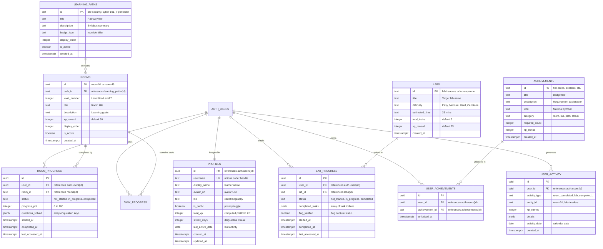

# Endlessus Academy 2.0 — Architecture & Learning Progress Specification

**Author:** Lead Full-Stack & Learning Experience Architect  
**Branch:** `feature/endlessus-2.0-accounts`  
**Target Repository:** `/home/mihraj/mihrajmashoor8301-collab.github.io`  
**Status:** Canonical Implementation & Production Blueprint  

---

## 1. System Architecture Overview

Endlessus Academy 2.0 transforms Endlessus into a persistent cybersecurity learning platform inspired by TryHackMe. The architecture is **client-first, offline-resilient, and powered by a dedicated Supabase PostgreSQL backend**.

```
                           +-------------------------------------------------+
                           |                Endlessus Browser                |
                           |  (Pure Vanilla HTML5 / CSS3 / ES6 / Tailwind)   |
                           +------------------------+------------------------+
                                                    |
                   +--------------------------------+--------------------------------+
                   |                                                                 |
                   v                                                                 v
+--------------------------------------+                          +--------------------------------------+
|       Client State & Persistence     |                          |      Academy Supabase Service        |
|  - academy-state.js (localStorage)   |                          |  - Supabase Auth (Email / OAuth)     |
|  - lab-engine.js (POSIX sandbox)     |                          |  - PostgreSQL 15 + RLS Policies      |
|  - Instant UI feedback & offline use |                          |  - Automatic Triggers & Milestones   |
+------------------+-------------------+                          +------------------+-------------------+
                   |                                                                 ^
                   +------------------- academy-sync.js -----------------------------+
                                (Two-Way Sync & Non-Destructive
                                 Local-to-Cloud Data Migration)
```

### Key Architectural Tenets:
1. **Total Product Separation:** Endlessus Academy is 100% separate from the multiplayer Quiz Platform (`quiz-platform-cloudflare`). They run on distinct repositories, separate databases, independent user pools, and decoupled auth sessions.
2. **Offline-First Resilience:** All learning content, questions, character slot validations, and POSIX terminal simulations continue to work seamlessly in local guest mode without network connection.
3. **Idempotent Progression:** XP (50 XP/room, 25 XP/question, 75 XP/lab) and achievements are awarded strictly once. Repeated task executions or network retries never inflate scores.
4. **Server-Side Milestone Verification:** Database triggers evaluate milestone criteria on completion events and award achievements with unique constraints.

---

## 2. Database Entity-Relationship Diagram (ERD)



---

## 3. Row Level Security (RLS) Policy Specifications

All user-owned tables enforce PostgreSQL Row Level Security:

1. **`profiles`:**
   - `SELECT`: `is_public = true OR id = auth.uid()`
   - `INSERT / UPDATE / DELETE`: `id = auth.uid()`
2. **`learning_paths`, `rooms`, `labs`, `achievements`:**
   - `SELECT`: Publicly accessible to all (`using (true)`).
   - Modifications restricted to database administrators.
3. **`room_progress` & `lab_progress`:**
   - `SELECT`: User can view their own progress, or view another user's progress if that user's profile is public.
   - `INSERT / UPDATE / DELETE`: Restricted strictly to `user_id = auth.uid()`.
4. **`user_achievements` & `user_activity`:**
   - `SELECT`: Visible if own record or if target user profile has `is_public = true`.
   - `INSERT`: Restricted strictly to `user_id = auth.uid()` or security definer triggers.

---

## 4. Milestone Achievements Matrix

| Achievement ID | Badge Title | Category | Requirement | Reward |
| :--- | :--- | :--- | :--- | :--- |
| `first-steps` | First Steps | Room | Complete 1 learning room | +50 XP |
| `explorer` | Explorer | Room | Complete 5 learning rooms | +100 XP |
| `dedicated-learner`| Dedicated Learner | Room | Complete 10 learning rooms | +150 XP |
| `security-enthusiast`| Security Enthusiast| Room | Complete 25 learning rooms | +250 XP |
| `pre-security-graduate`| Pre Security Graduate| Pathway | Complete all 45 Pre-Security rooms | +500 XP |
| `lab-practitioner` | Lab Practitioner | Practical Lab | Verify first practical lab flag | +100 XP |
| `lab-specialist` | Lab Specialist | Practical Lab | Complete 5 practical labs | +200 XP |
| `lab-master` | Master of the Sandbox| Practical Lab | Complete all 13 practical labs | +500 XP |
| `streak-week` | Consistent Operator| Cadence | Maintain a 7-day daily streak | +150 XP |

---

## 5. Non-Destructive Data Migration Specification

When a guest user registers or logs in:
1. `AcademySync.checkUnmigratedProgress(userId)` inspects `localStorage` for pre-existing room and lab completions.
2. If unmigrated progress exists, `AcademySync.migrateLocalProgress(userId)` batches upsert operations into Supabase `room_progress` and `lab_progress`.
3. Existing timestamps are preserved where available; existing server-side progress is never overwritten.
4. Server-side records are subsequently merged into the local state so the device stays 100% updated.
5. Migration state is flagged in `localStorage` under `endlessus_migrated_<userId>: true` to avoid duplicate prompts.
